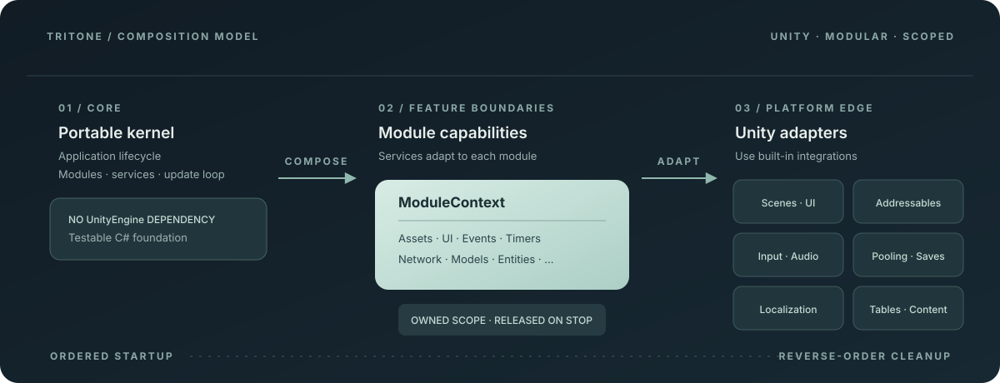

# Tritone

**面向 Unity 的模块化游戏框架：核心生命周期独立于 UnityEngine，资源由模块显式拥有。**

按项目需要组合服务；让模块负责释放自己获取的资源，让启动、更新、场景切换和关闭过程保持清晰、可预测。

[English](README.md) · [简体中文](README.zh-CN.md) · [日本語](README.ja.md)

[](https://unity.com/releases/editor/whats-new/2022.3.0)
[](https://github.com/TristinOrg/Tritone)
[](LICENSE)
[](https://github.com/TristinOrg/Tritone/stargazers)
[](https://github.com/TristinOrg/Tritone/actions/workflows/unity-package.yml)



## Tritone 的特点

- **轻量、可移植的内核。** 应用生命周期、模块、服务、流程、模型、实体、事件、计时器、补间、线程调度与运行时诊断不依赖 `UnityEngine`。
- **明确的资源所有权。** 模块作用域在模块停止时释放它持有的计时器、事件绑定、资源、对象池对象及其他已获取资源。
- **按需组合服务。** 从场景和 UI，到网络、内容分发、本地化、存档和数据表，项目只启用实际需要的能力。
- **可预测的状态切换。** 依赖按序启动、逆序停止；场景或流程激活失败时恢复先前可用状态。
- **包含编辑器工作流。** 可生成强类型 UI 视图，编译配置表和网络消息，并构建带版本的内容资源包。

Tritone 是 Unity Package Manager 框架包，不是预制游戏或完整模板。它面向现有项目，帮助团队按功能组织游戏代码。

## 功能一览

| 范围 | 功能 |
| --- | --- |
| 内核 | 模块化应用生命周期、依赖排序、服务注册表、作用域所有权、主线程调度 |
| 游戏架构 | 流程、共享模型、轻量实体世界、强类型事件、计时器、补间、运行时诊断 |
| Unity 运行时 | 启动组件、场景、UI 组合、输入、音频、对象池、资源、存档、设置、本地化、数据表 |
| 内容管线 | Resources、Addressables、AssetBundle、生成的内容清单、事务式远程更新 |
| 网络 | TCP 会话、重连、请求/响应路由、协议兼容握手、网络消息代码生成 |
| 编辑器工具 | UI 视图生成、数据表与消息生成、数据表编译、内容构建 |

## 目录

- [安装与开始](#安装)
- [Kernel 内核基础](#kernel-内核基础)
- [架构与生命周期](#模块上下文与能力)
- [游戏系统](#模型与状态快速开始)
- [Unity 集成](#ui-快速开始)
- [资源与内容分发](#资源快速开始)
- [数据表与网络](#配置表快速开始)
- [持续集成](#持续集成)
- [包文档](#包文档)

下文包含各系统的 API 示例与生命周期说明。完整的 UI 和数据表制作流程请参见包文档。

## 安装

在 Unity Package Manager 中选择 **Add package from git URL**，输入：

```text
https://github.com/TristinOrg/Tritone.git
```

生产项目建议指定发布标签以固定依赖版本；只有确实要跟踪主分支时才使用不带标签的 URL。项目要求 Unity 2022.3+ 和 Addressables 1.21.21（或兼容的更新版本）。

生产项目建议固定到当前发布标签：

```text
https://github.com/TristinOrg/Tritone.git#v0.2.0
```

## 持续集成

GitHub Actions 工作流会验证包元数据和 Unity GUID 完整性，并使用 Unity 2022.3 运行 EditMode 与 PlayMode 测试。配置 `UNITY_LICENSE`、`UNITY_EMAIL` 和 `UNITY_PASSWORD` 仓库密钥后才会运行 Unity 测试；缺少密钥时仍执行包验证，并明确提示跳过测试。

## Kernel 内核基础

首个里程碑提供：

- 不依赖 Unity 的纯 C# 应用生命周期。
- 支持显式模块依赖和拓扑排序启动。
- 逆序关闭及启动失败后的部分回滚。
- 轻量单例服务注册表。
- 无分配的 PreUpdate、Update、LateUpdate 与 FixedUpdate 分发。
- Unity 启动组件和支持多输出端的过滤式诊断日志。

## Unity 快速开始

创建一个模块：

```csharp
using Tritone.Kernel;

public sealed class HelloModule : ModuleBase, IUpdateSystem
{
    public int Order => 0;

    protected override ELogLevel LogLevel => ELogLevel.Debug;

    protected override void OnStart()
    {
        Logger.Info("Hello module started.");
    }

    public void Update(in FrameTime time)
    {
    }

    protected override void OnStop()
    {
        Logger.Info("Hello module stopped.");
    }
}
```

创建应用入口：

```csharp
using Tritone.Diagnostics;
using Tritone.Kernel;
using Tritone.Unity;

public sealed class GameBootstrap : TritoneBootstrap
{
    protected override void Configure(GameApplicationBuilder builder)
    {
        builder.UseLogging(ELogLevel.Debug, new UnityLogSink());
        builder.AddModule(new HelloModule());
    }
}
```

将 `GameBootstrap` 挂到启动场景中的一个 GameObject 上，然后进入 Play Mode。

## 模块上下文与能力

每个模块获得独立的 `ModuleContext`，它组合各项功能能力和一个通用的 `ModuleScope`：

```text
ModuleBase
    -> ModuleContext
        -> Assets / Timers / UI / Network / other capabilities
            -> Service contracts
            -> ModuleScope ownership
```

`ModuleBase` 保留 `LoadAsset`、`SetTimer`、`BindMessage` 等熟悉的辅助方法作为兼容门面。具体实现和所有权归属在专门的能力对象中。新框架功能也应遵循这个边界：服务契约承载共享行为，能力适配模块使用方式，模块作用域负责释放获取的资源。

需要清楚表达依赖时，模块也可直接使用能力：

```csharp
var prefab = await Context.Assets.LoadAsync<GameObject>("Characters/Player");
Context.Events.Bind(player.Events.HealthChanged, OnHealthChanged);
```

未使用的能力采用延迟创建，不会分配其专属作用域。

## 主线程调度

在使用异步服务的模块之前配置一个有界调度器：

```csharp
builder.UseMainThreadDispatcher(maxCallbacksPerUpdate: 4096);
```

工作线程完成任务后，将方法组投递到主线程；如果模块先停止，模块所有权会自动取消回调：

```csharp
private void OnDownloadCompleted()
{
    PostToMainThread(ApplyDownloadedContent);
}

private void ApplyDownloadedContent()
{
    // Safe to access Unity objects here.
}
```

`Context.MainThread.Post(callback)` 返回只读 `DispatchHandle`，可用于主动取消或查询待执行状态。生产者通过线程安全队列写入紧凑结构体，回调按确定的 FIFO 顺序在 `PreUpdate` 中执行。每帧上限避免工作线程积压占满帧预算；某个回调失败也不会阻止后续回调执行。

## 模型与状态快速开始

通过显式工厂和所有权生命周期注册共享状态：

```csharp
builder.AddApplicationModel<PlayerModel>();
builder.AddSceneModel(() => new BattleModel(mBattleRules));
```

模型以确定的生命周期运行，不依赖 Unity：

```csharp
public sealed class PlayerModel : IModel
{
    public readonly Event<int> LevelChanged = new();
    public int Level { get; private set; }

    public void Initialize() { Level = 1; }
    public void Reset() { Level = 1; LevelChanged.Clear(); }
    public void Dispose() { LevelChanged.Clear(); }
}
```

通过模块能力或兼容门面获取模型：

```csharp
var player = Context.Models.Get<PlayerModel>();
var battle = GetModel<BattleModel>();
```

模型首次访问时才创建，并按注册的具体类型共享。应用级模型跨场景保留，在应用停止时按创建逆序释放。场景模型要求场景模块处于活动状态，并在下一场景模块启动前释放。消费者不拥有共享实例，因此某个模块停止不会使其他模块仍在使用的状态失效。初始化失败会释放未完成的实例，同时保留注册以便稍后重试。

## 游戏流程快速开始

显式注册应用流程：

```csharp
builder.AddFlow(() => new LoginFlow(mLoginConfig));
builder.AddFlow<LobbyFlow>();
builder.AddFlow<BattleFlow>();
```

一个流程负责一个较高层级的应用阶段：

```csharp
public sealed class LoginFlow : IFlow
{
    public async Task EnterAsync(CancellationToken cancellationToken)
    {
        await LoadLoginDataAsync(cancellationToken);
    }

    public void Update(in FrameTime time) { }
    public void Exit() { }
    public void Dispose() { }
}
```

从模块能力或兼容门面切换流程：

```csharp
await Context.Flows.SwitchAsync<LoginFlow>(cancellationToken);
await SwitchFlowAsync<BattleFlow>(cancellationToken);
```

同一时间只有一个活动流程。目标相同的并发切换会共用正在执行的转换；目标冲突则拒绝执行。当前流程先退出，目标进入成功后才释放旧流程。进入失败或被取消时，未完成的目标会被释放，之前的流程重新进入。应用停止时活动流程会更新并自动退出。

## 实体世界快速开始

在拥有该世界的生命周期中显式注册结构体组件数据和有序系统：

```csharp
builder.UseEntities(initialCapacity: 256);
builder.AddApplicationComponent<PlayerIdentity>();
builder.AddSceneComponent<Position>();
builder.AddSceneComponent<Velocity>();
builder.AddSceneEntitySystem<MovementSystem>();
```

组件数据保持为普通值类型：

```csharp
public struct Position : IEntityComponent
{
    public float X;
    public float Y;
}
```

创建实体并按引用修改组件：

```csharp
EntityWorld world = Context.Entities.Scene;
EntityId entity = world.Create();
world.Add(entity, new Position { X = 10.0f, Y = 0.0f });

ref Position position = ref world.Get<Position>(entity);
position.X += 5.0f;
```

查询对象是轻量结构体。索引遍历不分配枚举器，组件可直接按引用访问。`EntityId` 同时包含槽位索引和代数；实体销毁后，即使槽位被重用，旧 ID 也不能访问新实体。应用世界跨场景保留；场景世界在场景模块配置前创建，并在该模块停止后释放其系统、实体和组件。实体系统按稳定顺序初始化、先于普通模块更新，并按逆序关闭。

## 补间与序列快速开始

只需启用一次共享补间调度器：

```csharp
builder.UseTweens();
```

通过模块持有的 setter 对数值进行补间：

```csharp
Tween(
    0.0f,
    1.0f,
    0.25,
    value => mCanvasGroup.alpha = value,
    ETweenEase.OutCubic);
```

调度器不依赖 Unity 类型，可用于 UI、Transform、音量、模型或纯模拟状态。高频创建补间时，可缓存方法组委托以避免调用方闭包分配。

在逐帧路径之外构建不可变序列并复用：

```csharp
TweenSequence sequence = new TweenSequenceBuilder()
    .Append(0.0f, 1.0f, 0.2, SetAlpha, ETweenEase.OutQuad)
    .AppendDelay(0.1)
    .AppendCallback(OnShown)
    .Build();

TweenHandle handle = PlayTweenSequence(sequence);
PauseTween(handle);
ResumeTween(handle);
CancelTween(handle);
```

序列会将步骤边界处未使用的帧时间带入下一步，支持有限或无限循环，并可选择缩放或非缩放时钟。在补间回调中新增的调度会从应用下一帧开始，防止同帧递归。setter 或完成回调失败只会影响对应补间。拥有它的模块或场景模块停止时，活动补间会自动取消。

## 运行时诊断快速开始

配置采样状态和固定容量的近期日志缓冲区。其他输出端可继续把相同日志转发到 Unity Console：

```csharp
builder.UseRuntimeDiagnostics(
    ELogLevel.Debug,
    logCapacity: 256,
    sampleWindow: 0.5,
    new UnityLogSink());
```

在代码中读取最新的无分配快照：

```csharp
var diagnostics = application.Services.GetRequired<IRuntimeDiagnosticsService>();
var snapshot = diagnostics.Snapshot;

Logger.Info($"FPS: {snapshot.FramesPerSecond:F1}");
Logger.Info($"Scene entities: {snapshot.SceneEntities}");
```

快照包含应用状态、活动场景模块和流程、应用与场景实体数量、FPS、帧时间平均值/最小值/最大值以及帧序号。近期日志通过固定容量环形缓冲区按时间顺序保存，满时覆盖最早的事件。

可将 `RuntimeDiagnosticsOverlay` 加到 Bootstrap GameObject 上启用可选的运行时 IMGUI 面板。默认按 F3 切换。面板与诊断服务彼此独立，项目可替换自己的 UI，而无需改动日志或采样实现。

## 计时器快速开始

只需注册一次共享计时器调度器：

```csharp
builder.UseTimers();
builder.AddModule(new GameplayModule());
```

`ModuleBase` 可直接使用整数或字符串键：

```csharp
protected override void OnStart()
{
    SetTimer("Refresh", 2.0, OnRefresh);
    SetRepeatedTimer(1001, 1.0, OnSecondPassed);
}

private void OnSecondPassed()
{
    Logger.Debug("One second passed.");
}

private void OnRefresh()
{
    CancelTimer(1001);
}
```

每个模块可拥有多个带键计时器；设置相同键会替换旧计时器。模块停止会自动取消它拥有的全部计时器并清除键缓存。高频调度时请缓存方法组委托；捕获变量的 lambda 仍可能产生分配。

## 事件快速开始

将强类型事件放在拥有这些事件的模块中：

```csharp
public sealed class PlayerModule : ModuleBase
{
    public EventsList EventsList { get; } = new();

    public sealed class EventsList
    {
        public readonly Event<int> HealthChanged = new();
        public readonly Event<int, PlayerData> PlayerDied = new();
    }

    private void NotifyHealthChanged(int health)
    {
        EventsList.HealthChanged.Publish(health);
    }
}
```

## UI 快速开始

完整的 Prefab 到模块制作流程请参见[UI 制作与组合](Documentation~/ui-authoring.md)。

在 View 中保存 Prefab 引用，不放置业务逻辑：

```csharp
public sealed class UIShopView : UIView
{
    public Button        BtnClose;
    public Button        BtnRule;
    public RectTransform NodePanels;
}
```

对于基于 Prefab 的制作流程，在 UI Prefab 根节点添加 `UIPrefabRef`。在 Inspector 中拖入子 GameObject 或 Component 并选择准确的组件类型，然后执行：

1. `Generate UIView Script` 在指定的 Assets 目录生成确定性的 `// <auto-generated />` View 源码。
2. Unity 编译后执行 `Bind Generated UIView`，添加生成的组件并赋值所有强类型引用。
3. `Preprocess Sorting Hierarchy` 按制作时视觉顺序和层级深度记录嵌套 Canvas 与 Renderer 节点。

打开窗口会将其置于逻辑 UI 层的最上方。Tritone 为预处理过的节点分配连续运行时排序值。每个 `EUILayer` 拥有独立的排序区间，避免不同窗口的嵌套 Canvas、粒子、Sprite 和 Trail 相互冲突。修改 Prefab 渲染层级或制作时排序值后，请重新预处理。

在窗口专属绑定阶段绑定 Unity 控件和 Tritone 事件：

```csharp
public sealed class ShopWindow : UIWindow<UIShopView>
{
    protected override void OnBindEvents()
    {
        BindButton(mView.BtnClose, Close);
        BindButton(mView.BtnRule, OnRule);

        var playerModule = GetModule<PlayerModule>();
        BindEvent(playerModule.EventsList.HealthChanged, OnHealthChanged);
    }

    private void OnHealthChanged(int health) { }
    private void OnRule() { }
}
```

`UIElement<TView>` 只解析一次 View，在 `OnBindEvents` 中绑定监听器，并在禁用时释放所有 Unity 与 Tritone 监听器。模块停止时会释放 `ModuleBase` 的全部绑定。

每个窗口可注册可复用条目模板和单实例面板。条目 Prefab 延迟加载并使用共享 Prefab 池；面板延迟创建，并在一次窗口活动周期内保留一个实例。关闭窗口会归还所有组合实例；释放窗口时也会释放已加载的模板资源。动态子 View 共享所属窗口的排序序列。

在 Bootstrap 中启用资源、对象池和 UI，然后让模块注册其拥有的窗口：

```csharp
protected override void Configure(GameApplicationBuilder builder)
{
    builder.UseAssets();
    builder.UsePools();
    builder.UseUI(mUIRoot);
    builder.AddModule(new ShopModule());
}
```

```csharp
public sealed class ShopModule : ModuleBase
{
    protected override void OnConfigure(IServiceRegistry services)
    {
        AddWindow<ShopWindow>("UI/Shop/ShopWindow", EUILayer.Normal);
    }

    private void ShowShop()
    {
        OpenWindow<ShopWindow>();
    }

    private async Task ShowShopAsync()
    {
        await OpenWindowAsync<ShopWindow>();
    }
}
```

只要至少一个活动模块拥有对应定义，模块窗口就可用。重复注册必须使用相同路径、层级和生命周期。最后一个所有者释放时会关闭窗口、销毁缓存实例、释放 Prefab 并删除定义。应用级窗口则保持可用直到应用停止。

## 场景模块切换

常驻基础设施模块随应用启动。场景模块以工厂注册，仅在进入时创建：

```csharp
builder.UseTimers();
builder.UseAssets();
builder.UseUI(mUIRoot);
builder.UseScenes();
builder.AddSceneModule<LoginModule>();
builder.AddSceneModule(() => new BattleModule(mBattleConfig));
```

从 `ModuleBase` 或 `TritoneComponent` 加载目标 Unity 场景并激活其模块：

```csharp
await SwitchSceneAsync<LoginModule>("Login", OnSceneProgress);
await SwitchSceneAsync<BattleModule>("Battle");
```

目标场景先以 Additive 方式加载，再停止旧模块。之后 Tritone 激活目标场景、创建全新的场景模块，并卸载前一场景。相同的并发请求会共用操作；冲突目标会被拒绝。加载失败时旧场景和模块保持不变；模块启动失败时恢复旧场景并重新创建旧模块。

`TritoneBootstrap` 在场景卸载期间自动保留。场景模块停止时会释放其计时器、事件绑定、窗口、对象池、资源和数据表。需要跨场景保留的数据应放在持久模型模块中。仅切换逻辑模块而不加载 Unity 场景时使用 `SwitchModule<TModule>()`。

## 对象池快速开始

启用一次共享延迟对象池，无需预先注册类型或 Prefab：

```csharp
builder.UsePools();
```

在 `ModuleBase` 中租用并归还普通 C# 对象：

```csharp
var damageData = Rent<DamageData>();
Return(ref damageData);
```

可直接实例化并回收 Unity Component 或 GameObject Prefab。`ref` 重载成功归还后会清空调用方引用；首次请求时才创建相应的类型池或 Prefab 池。模块或 `TritoneComponent` 释放时，仍处于活动状态的对象会自动归还。`UIElement` 关闭时也会归还其当前启用周期生成的全部对象。仅当对象需要生成/回收重置回调时才实现 `IPoolable`。

## 基础体验服务

以下可选服务均可按需启用：

```csharp
builder.UseAssets();
builder.UseAudio();
builder.UseSaves();
builder.UseSettings();
builder.UseTables();
builder.UseLocalization("en");
```

音频可从模块或 Tritone Component 直接调用：

```csharp
PlayMusic("Audio/Music/Login");
var click = PlaySound("Audio/SFX/Click");
StopSound(click);
```

强类型存档以原子方式保存：

```csharp
Save("slot1", playerSave);

if (TryLoadSave<PlayerSave>("slot1", out var loaded))
    ApplySave(loaded);
```

设置保存在内存中，直到调用 `Settings.Save()` 或应用关闭。设置本地化时，框架会从 `Localization/{language}` 读取每种语言的可热更新 JSON 数据表。`Localize("UI.Login.Title")` 可查询文本；`SetLanguageAsync("zh-CN")` 可切换语言。

## 资源快速开始

默认使用 Unity Resources 提供器加载资源：

```csharp
builder.UseAssets();

var config = LoadAsset<TextAsset>("Configs/GameConfig");
var prefab = await LoadAssetAsync<GameObject>("UI/LoginWindow");
ReleaseAsset(config); // 手动释放可选
```

相同路径和类型的请求共享缓存；并发异步请求也会合并为一次提供器操作。所有者模块停止或 `TritoneComponent` 销毁时，会自动释放仍持有的引用。实现 `IAssetProvider` 并传入 `UseAssets(provider)` 可替换为 Addressables 或其他后端。

启用 Addressables 后可执行远程目录更新和依赖预加载。预加载会跳过缓存内容、报告字节进度，并释放 Addressables 操作句柄。

## 配置表快速开始

完整的源文件、诊断信息、扩展方式和 CI 流程请参见[配置表制作指南](Documentation~/table-authoring.md)。创建 `Assets/Tritone/Tables.json`，运行 `Tritone/Generate/Tables`，即可生成强类型行定义，而不必手动维护样板代码。

编译器递归发现配置目录下的 CSV 和 TSV 文件；文件名成为生成的表类型，文件相对路径成为 JSON 输出路径。每个源文件自描述：第一行是字段名，第二行是字段类型，之后为数据；第一列是稳定主键。

编译器在输出前检查字段类型、必填单元格、重复主键、重复表名及冲突字段架构；源单元格错误会带有文件、行和列诊断。内置类型为 `bool`、`int`、`long`、`float`、`double` 和 `string`。也可使用 `TableCompilerBuilder` 组合自定义源读取器、字段类型、验证器、代码生成器和数据写入器。

启用表格并定义行：

```csharp
builder.UseAssets();
builder.UseTables();

[Serializable]
public sealed class RoleRow : ITableRow<int>
{
    public int Id;
    public string Name;
    public int Key => Id;
}
```

```csharp
var roles = LoadTable<int, RoleRow>("Tables/Roles");
var tristin = roles.Get(1001);

if (roles.TryGet(1002, out var aigis))
    Logger.Info(aigis.Name);
```

首次加载会反序列化并建立索引；重复加载共享已解析表，并发异步请求也会合并。主键查询为常数时间，`GetAt(index)` 可按源顺序无分配遍历。重复主键在索引阶段立即报错。手动释放可用 `ReleaseTable(ref roles)`；模块停止时会自动释放仍拥有的表和底层 TextAsset。传入自定义 `ITableDeserializer` 可以改用生成式二进制格式而保持游戏加载 API 不变。

## 网络消息生成

创建 `Assets/Tritone/Network.json` 并运行 `Tritone/Generate/Network Messages`。将生成的 codec 注册一次：

```csharp
MessageSerializer serializer = new();
NetworkMessages.Register(serializer);
```

连接或登录握手时交换生成的协议描述符，在发送游戏消息前拒绝不兼容的对端。主版本必须相同，双方次版本必须分别落在对方声明的兼容范围内。版本号相同时还需具有一致的确定性 SHA-256 架构指纹，以捕获未升级协议版本却改变 wire 格式的情况。

可在传输连接后、开放游戏消息前启用自动验证：

```csharp
var options = new NetworkSessionOptions()
    .UseProtocolHandshake(in NetworkMessages.Protocol, timeoutSeconds: 10.0)
    .UseReconnect();
builder.UseTcpNetwork(serializer, options: options);
```

每次初始连接或重连后，客户端都会发送框架控制帧。`ConnectAsync` 只有在服务器接受协议后才完成。不兼容会抛出 `NetworkProtocolHandshakeException` 并断开连接；验证通过前无法发送应用消息或请求。使用项目自定义验证逻辑时，可调用 `UseHandshake(customHandshake)` 组合身份验证或平台凭据。

生成器会检查消息 ID、重名、请求/响应关系和支持的字段类型。支持 `bool`、`byte[]`、`float`、`int` 和 `string`。存在数据表和网络 Schema 时，可运行 `Tritone/Generate/All` 一次更新二者。

## 本地 AssetBundle 提供器

可组合 Bundle 及资源注册后再构建应用：

```csharp
AssetBundleRegistry registry = new();
registry.AddBundle("core", "core.bundle")
        .AddBundle("shared", "shared.bundle", "core")
        .AddBundle("ui", "ui.bundle", "shared")
        .AddAsset("UI/LoginWindow", "ui", "Assets/Game/UI/LoginWindow.prefab");

var bundleRoot = Path.Combine(Application.persistentDataPath, "Bundles");
var source = new FileAssetBundleSource(bundleRoot);
var provider = new AssetBundleAssetProvider(registry, source);
builder.UseAssets(provider);
```

游戏模块仍使用相同的 `LoadAssetAsync<GameObject>("UI/LoginWindow")` API。注册表会检查缺失依赖和循环，并预先计算确定的依赖优先加载顺序。资源会共享已加载 Bundle 和进行中的 Bundle 请求；最后一个资源释放后，会按逆序卸载根 Bundle 及其依赖。创建提供器后注册表不可再变更。`FileAssetBundleSource` 是本地第一阶段来源，远程来源可实现 `IAssetBundleSource` 而不必修改运行模块。

## 内容更新规划与事务式更新

`ContentManifest` 以 Bundle 与资源条目描述已安装或远程版本。`ContentUpdatePlanner.CreatePlan(localManifest, remoteManifest)` 会比较文件名、哈希和大小，而不是只信任版本标签；可识别逻辑 Bundle 改名后仍可复用的本地文件，单独报告废弃文件，并保持远程清单顺序以确保下载顺序确定。

通过 `UseContentAssets(options)` 同时配置远程更新和本地 AssetBundle 加载；此时不要另外调用 `UseAssets`。模块可用 `StartContentUpdate` 启动更新，或在已有异步启动流程中等待 `UpdateContentAsync`。模块停止会取消请求。

更新器串行执行并发检查，将下载流写入临时文件，验证精确大小和小写 SHA-256 后才进入不可取消的提交阶段。事务在 `.tritone-update` 下保存备份和创建标记；验证失败不会影响活动文件，提交失败会恢复所有替换或删除文件以及旧清单。进程在提交期间退出时，下次检查会先恢复未完成事务。活动资源仍加载或正在加载时，更新门会拒绝操作；事务期间阻止新加载，所有 Bundle 操作成功后才激活新清单。

应用构造时就会加载已安装清单，因此远程检查失败时仍可使用已有验证版本。请在加载内容资源之前完成更新，因为磁盘上的文件变化无法替换已经在内存中的 AssetBundle 或 Prefab 实例。

## 内容构建

通过 Unity 导入设置分配 AssetBundle 名称，设置 `PlayerSettings.bundleVersion`，然后运行 `Tritone > Build > Content for Active Platform`。Tritone 会将 Bundle 和运行时兼容的 `manifest.json` 写入 `ContentBuilds/<platform>/<version>`。每项包含确定的直接依赖、文件大小和小写 SHA-256；默认以项目内资源路径作为公开地址。

构建自动化可提供稳定地址并指定输出路径。若配置的资源没有分配到已构建 Bundle、输出 Bundle 缺失或运行时清单无效，构建会在发布清单前失败。将版本目录原样上传，并令 `ContentUpdateOptions` 指向其中的 `manifest.json`。

## 包文档

- [UI 制作与组合](Documentation~/ui-authoring.md)
- [配置表制作指南](Documentation~/table-authoring.md)
- [包概览](Documentation~/index.md)
- [更新日志](CHANGELOG.md)
- [路线图](ROADMAP.md)

## 参与和支持

问题反馈、缺陷报告和功能建议请提交到 [GitHub Issues](https://github.com/TristinOrg/Tritone/issues)。报告问题时请附 Unity 版本和最小复现步骤。

Tritone 以 Unity Package Manager 包形式维护。许可条款请参见 [LICENSE](LICENSE)。
