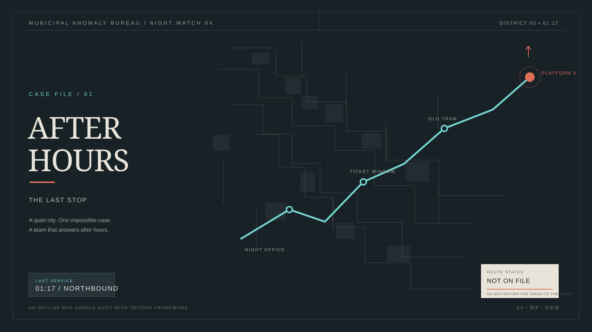

# Tritone Feature Playground

### Tritone を試す Unity 向けの小さな独立サンプル



**機能を選び、操作を 1 回試して、結果を確認します。**

この Sample は Tritone の機能を個別に確認できる独立シーン集です。ローカルのデモはゲームを遊ばなくても理解できるよう、一つの機能に絞っています。Sample Hub から開始し、各シーンで操作して Hub に戻れます。

墨色のネイビー、温かみのある紙色、路線図の幾何学模様、控えめな青緑を使ったビジュアルです。バナーは Sample に含まれる SVG です。

**言語：** [English](README.md) · [简体中文](README.zh-CN.md) · 日本語

---

## Unity で始める

1. Unity 2022.3 LTS に Tritone をインストール、または開きます。
2. Package Manager で Tritone を選び、**Samples** から **Tritone Feature Playground** を Import します。
3. Unity の Project ウィンドウで、インポートした **Tritone Feature Playground** フォルダーを `Assets` に移動し、`AfterHours` に名前を変更します。編集ツールは `Assets/AfterHours` を使用します。
4. 初回のみ **Tritone → After Hours → Generate Sample Scenes** を実行します。サンプル Scene を生成して Build Settings に登録します。ホスト Scene は変更しません。
5. `AfterHours/Scenes/SampleHub.unity` を開いて **Play** を押します。
6. **Timer Lab** または確認したい機能カードを選びます。強調表示されたボタンを押して結果を見たら、**Reset** または **Back to Hub** を使います。

ローカルデモにサーバー、アカウント、ネット接続は不要です。Network サンプルでは任意でループバック Relay を使用できます。手順は Scene と以下に記載しています。

## デモを選ぶ

| Sample | 操作 | 表示される結果 |
| --- | --- | --- |
| **Timer Lab** | Run Timer | Tritone が One-shot Timer を実行し、Callback の発生を表示します。Reset で待機中の Timer をキャンセルします。 |
| **ECS** | Spawn Signal | Scene World に Entity が追加され、Component Query 数と System Pulse が変化します。Reset で World を消去します。 |
| **UI** | Open Window | Tritone の生成 Window が Popup Layer に表示されます。閉じて再度開くと、Binding と Lifetime を確認できます。 |
| **Typed Tables** | Load Table | Tritone が生成済み `ClueRow` データを読み込み、行数と最初の Row を表示します。 |
| **Content Update** | Content Workshop を開く | 独立した Profile でローカル更新と復旧の手順を確認します。 |
| **Addressables** | Addressables Desk を開く | Addressables Provider を使う Profile を個別に確認します。 |
| **AssetBundle** | Bundle Desk を開く | AssetBundle Provider を使う Profile を個別に確認します。 |
| **Network** | Network Desk を開く | 生成 Protocol と任意のローカル Relay の Request/Response を確認します。 |

Hub には独立した各 Scene のカードを 1 枚ずつ表示します。詳細な Feature Index では、各 Tritone 機能を対応するデモ、任意 Profile、正確な Editor コマンドに割り当てています。

## Tritone の機能範囲

- **Application と Module：** Bootstrap 構成、Module 順序、Application/Scene Lifetime、Context、Scope、Scene Module、Scene 切り替え。
- **Runtime Service：** 診断と構造化ログ、メインスレッド Dispatch、型付き Event、Timer、Tween、Object Pool、Input、Audio、Model、Save、Settings、Localization。
- **Entity：** Entity World、Component 登録、Query、順序付き System。
- **UI：** `UIWindow`、生成された `UIView` 参照、Prefab Binding、Popup Sorting、Window Lifetime。
- **Table：** Schema に基づく型付き Row、CSV/JSON 入力、コード生成、Runtime 読込、サンプル Validator。
- **Content：** Resources、Addressables、AssetBundle Provider、Manifest、Update Plan、Integrity Check、Transaction Recovery。
- **Network：** 生成 Message、TCP Session、Protocol Compatibility、Heartbeat、Reconnect。
- **Editor Workflow：** Provider 設定、Scene 作成、UI Binding、Table/Network 生成、Content Build。

Editor 専用コマンドは対応する Sample と `Tritone/After Hours/…` メニューに記載します。Runtime の操作ボタンとは区別しています。

## 任意のローカル Profile

Addressables、AssetBundle、Content Update、Network は別々の Bootstrap を使います。試したい Profile だけを実行してください。ローカルの機能デモには統合されません。

- **Content Update：** **Tritone → After Hours → Prepare Provider Labs**、続けて **Build Local Bundle and Update Manifest** を実行します。`node "<Import した Sample フォルダー>/LocalServices/content-host.js"` で同梱の Loopback Content Host を起動します。
- **Addressables：** Host Project に Unity Addressables を導入または有効化し、**Prepare Provider Labs** と **Build Addressables Lab Content** を実行します。
- **AssetBundle：** **Prepare Provider Labs** の後に **Build Local Bundle and Update Manifest** を実行します。
- **Network：** Terminal で `node "<Import した Sample フォルダー>/LocalServices/relay.js"` を起動して **Network Desk** を開きます。Relay は `127.0.0.1` のみで待ち受けます。

任意の依存関係を使えなくても、Hub とオフラインデモは利用できます。

## Authoring コマンド

Sample を Import した後、Unity の **Tritone → After Hours** を開きます。

- **Generate Sample Scenes** — Hub と独立デモ Scene を作り、Build Settings に追加します。
- **Regenerate Table Outputs** — `Schemas/Tables.json` と CSV から型付き Row と JSON を生成します。Sample の `ITableValidator` が入力データを検査します。
- **Regenerate Network Messages** — `Schemas/Network.json` から Message 型、Codec、Registry、Schema Fingerprint を生成します。
- **Generate Systems Window View** / **Bind Generated Systems Window View** — 型付き UI View を生成して Binding します。
- **Prepare Provider Labs** — Provider ごとの Sample Content を準備します。
- **Build Addressables Lab Content** / **Build Local Bundle and Update Manifest** — 任意の Asset Profile を構築します。
- **Tritone → Build → Content for Active Platform** — 選択中の Unity Target で共通 Content Build を実行します。

## Package 構成

```text
AfterHours/
├── Art/                 同梱 SVG バナー
├── Data/                CSV Sample データ
├── Editor/              Scene、Table、UI、Network、Content の Authoring Tool
├── LocalServices/       任意の Loopback Relay と Content Host
├── Runtime/             独立デモ Bootstrap、UI、Data、生成コード
├── Schemas/             Table と Network の Schema
├── Scenes/              Hub と独立機能/Profile Scene
└── Tests/EditMode/      Sample データ、Catalog、Rule のテスト
```

## 検証

Tritone Repository の Root から実行します。

```powershell
.\.ci\Validate-Package.ps1
```

Unity Test Runner で `AfterHours.Sample.Tests` EditMode Assembly を実行すると、Catalog Route、Sample Data、Demo Rule を確認できます。

---

**[English](README.md)** · **[简体中文](README.zh-CN.md)**

