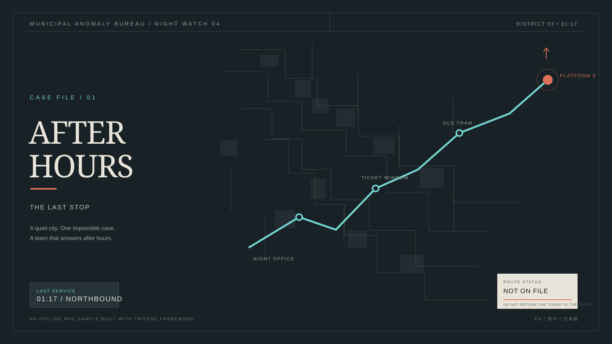

# Tritone Feature Playground

### Small, independent Unity demos for Tritone



**Choose one feature. Try one action. See one result.**

This sample is a set of separate, offline-first scenes for exploring Tritone. Each local demo focuses on a single framework capability and can be understood without playing a game. The Sample Hub is the launcher; every scene has a clear action and a way back.

The visual language uses ink-dark navy, warm paper, transit-map geometry, and restrained signal teal. The banner is an authored SVG included with the sample.

**Languages:** English · [简体中文](README.zh-CN.md) · [日本語](README.ja.md)

---

## Start in Unity

1. Install or open Tritone in Unity 2022.3 LTS.
2. In Package Manager, select Tritone and import **Tritone Feature Playground** from **Samples**.
3. In Unity's Project window, move the imported **Tritone Feature Playground** folder to `Assets` and rename it to `AfterHours`. The authoring tools use `Assets/AfterHours`.
4. Run **Tritone → After Hours → Generate Sample Scenes** once. This creates the sample scenes and adds their routes to Build Settings; it does not change your host scene.
5. Open `AfterHours/Scenes/SampleHub.unity` and press **Play**.
6. Choose **Timer Lab** or any feature card. Click its highlighted action, read the result, then use **Reset** or **Back to Hub**.

No server, account, or network connection is required for the local demos. The Network sample uses an optional loopback relay described in its scene and below.

## Pick a demo

| Sample | Try this | What you see |
| --- | --- | --- |
| **Timer Lab** | Run Timer | Tritone schedules a one-shot timer and reports when its callback fires. Reset cancels a pending timer. |
| **ECS** | Spawn Signal | The scene World gains an entity; the component query count and system pulse update. Reset clears the World. |
| **UI** | Open Window | A generated Tritone window appears on the Popup layer. Close and reopen it to see window ownership and binding. |
| **Typed Tables** | Load Table | Tritone reads generated `ClueRow` data and shows the row count and first record. |
| **Content Update** | Open Content Workshop | Inspect the local content update and recovery workflow in its separate profile. |
| **Addressables** | Open Addressables Desk | Try the Addressables-backed asset profile independently. |
| **AssetBundle** | Open Bundle Desk | Try the AssetBundle-backed asset profile independently. |
| **Network** | Open Network Desk | Inspect the generated protocol and optional local relay request/response flow. |

The Hub shows one card for each independent scene. The complete Feature Index still maps related Tritone capabilities to their focused sample, optional profile, or exact Editor command.

## Feature coverage

- **Application and modules:** bootstrap composition, module ordering, application/scene lifetime, contexts, scopes, scene modules and scene transitions.
- **Runtime services:** diagnostics and structured logs, main-thread dispatch, typed events, timers, tweens, object pooling, input, audio, models, saves, settings and localization.
- **Entities:** entity worlds, component registration, queries and ordered systems.
- **UI:** `UIWindow`, generated `UIView` references, prefab binding, popup sorting and window lifetime.
- **Tables:** schema-driven typed rows, CSV/JSON input, generation, runtime loading and sample validation.
- **Content:** Resources, Addressables and AssetBundle providers; content manifests, update planning, integrity checks and transactional recovery.
- **Networking:** generated messages, TCP sessions, protocol compatibility, heartbeat and reconnect behavior.
- **Editor workflows:** provider setup, scene authoring, UI binding, table/network generation and content builds.

Editor-only commands are listed in the relevant sample and use the `Tritone/After Hours/…` menu. They are not presented as runtime buttons.

## Optional local profiles

The Addressables, AssetBundle, content-update and Network samples are separate bootstraps. Run only the profile you want to inspect; they do not get combined with the local feature demos.

- **Content update:** run **Tritone → After Hours → Prepare Provider Labs**, then **Build Local Bundle and Update Manifest**. Start the included loopback content host with `node "<imported sample folder>/LocalServices/content-host.js"`.
- **Addressables:** install/enable Unity Addressables for the host project, then run **Prepare Provider Labs** and **Build Addressables Lab Content**.
- **AssetBundle:** run **Prepare Provider Labs**, then **Build Local Bundle and Update Manifest**.
- **Network:** start `node "<imported sample folder>/LocalServices/relay.js"` from a terminal, then use **Network Desk**. The relay binds to `127.0.0.1` only.

If an optional dependency is unavailable, the Hub and offline demos still work.

## Authoring commands

After importing the sample, use **Tritone → After Hours** in Unity:

- **Generate Sample Scenes** — create Hub and focused demo scenes; add them to Build Settings.
- **Regenerate Table Outputs** — compile `Schemas/Tables.json` and CSV into typed rows and JSON resources. The sample `ITableValidator` checks the authored clue data.
- **Regenerate Network Messages** — generate message types, codecs, registry and schema fingerprint from `Schemas/Network.json`.
- **Generate Systems Window View** / **Bind Generated Systems Window View** — generate and bind the strongly typed sample UI view.
- **Prepare Provider Labs** — set up provider-specific sample content.
- **Build Addressables Lab Content** / **Build Local Bundle and Update Manifest** — build the selected optional asset profile.
- **Tritone → Build → Content for Active Platform** — run the shared content build for the selected Unity target.

## Package layout

```text
AfterHours/
├── Art/                 authored SVG banner
├── Data/                sample CSV sources
├── Editor/              scene, table, UI, network and content authoring
├── LocalServices/       optional loopback relay and content host
├── Runtime/             isolated demo bootstraps, UI, data and generated code
├── Schemas/             table and network schemas
├── Scenes/              Hub and individual feature/profile scenes
└── Tests/EditMode/      sample data, catalog and rule tests
```

## Validation

From the Tritone repository root, validate the package with:

```powershell
.\.ci\Validate-Package.ps1
```

Run the `AfterHours.Sample.Tests` EditMode assembly in Unity Test Runner to verify catalog routes, sample data and demo rules.

---

**[中文文档](README.zh-CN.md)** · **[日本語ドキュメント](README.ja.md)**

