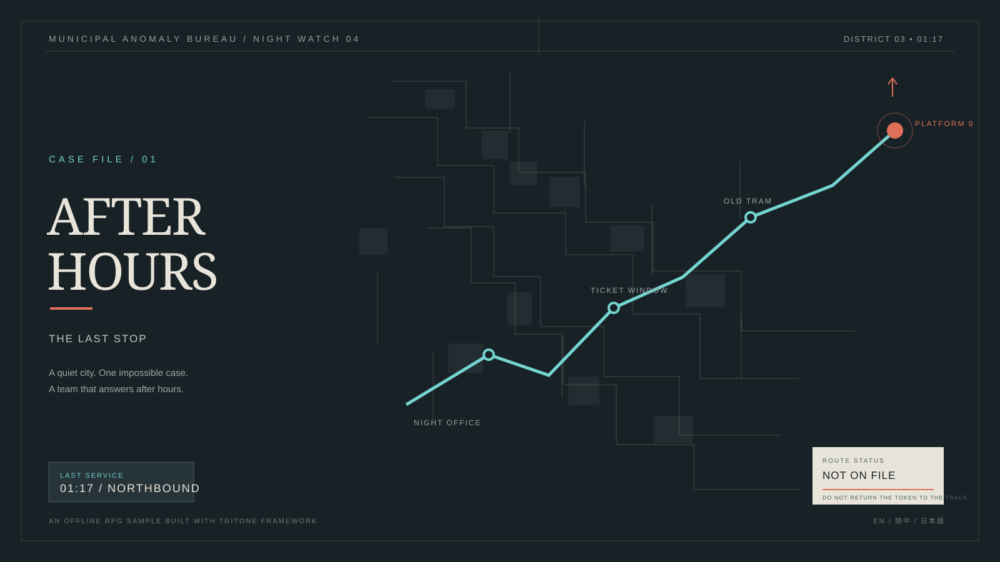

# Tritone 功能演示集

### 面向 Tritone 的 Unity 独立小型示例



**选择一个功能，点击一次操作，直接查看结果。**

这个 Sample 由多个独立场景组成，方便逐项了解 Tritone。每个本地演示只聚焦一个框架能力，不需要先玩懂游戏。Sample Hub 是统一入口；每个场景都有明确操作和返回目录的按钮。

视觉使用墨色深蓝、暖纸色、城市线路几何和克制的青绿色。横幅是随 Sample 提供的 SVG 图形。

**语言：** [English](README.md) · 简体中文 · [日本語](README.ja.md)

---

## 在 Unity 中开始

1. 在 Unity 2022.3 LTS 中安装或打开 Tritone。
2. 打开 Package Manager，选择 Tritone，并从 **Samples** 导入 **Tritone Feature Playground**。
3. 在 Unity 的 Project 窗口中，将导入的 **Tritone Feature Playground** 文件夹移动到 `Assets` 下，并重命名为 `AfterHours`。编辑器工具使用 `Assets/AfterHours` 路径。
4. 首次运行 **Tritone → After Hours → Generate Sample Scenes**。此命令会生成示例场景并将入口加入 Build Settings，不会更改宿主场景。
5. 打开 `AfterHours/Scenes/SampleHub.unity`，点击 **Play**。
6. 选择 **Timer Lab** 或其他功能卡片。点击高亮按钮，查看结果，然后使用 **Reset** 或 **Back to Hub**。

本地演示无需服务器、账号或网络。Network 示例可选使用本机回环 Relay，具体步骤见场景和下文。

## 选择演示

| Sample | 操作 | 结果 |
| --- | --- | --- |
| **Timer Lab** | Run Timer | Tritone 安排一次性计时器，并显示回调触发结果。Reset 会取消等待中的计时器。 |
| **ECS** | Spawn Signal | 场景 World 新增实体；组件查询数量和系统脉冲随之更新。Reset 会清空 World。 |
| **UI** | Open Window | Tritone 生成的窗口显示在 Popup 层。关闭并重新打开，可观察窗口绑定和生命周期。 |
| **Typed Tables** | Load Table | Tritone 加载生成的 `ClueRow` 数据，并显示行数和第一条记录。 |
| **Content Update** | 打开 Content Workshop | 在独立配置中查看本地内容更新和恢复流程。 |
| **Addressables** | 打开 Addressables Desk | 独立体验基于 Addressables 的资源配置。 |
| **AssetBundle** | 打开 Bundle Desk | 独立体验基于 AssetBundle 的资源配置。 |
| **Network** | 打开 Network Desk | 查看生成协议以及可选本机 Relay 的请求/响应流程。 |

Hub 每个独立场景只显示一张卡片。完整 Feature Index 仍会把 Tritone 能力映射到对应演示、可选配置或精确的 Editor 命令。

## Tritone 能力覆盖

- **应用与模块：** Bootstrap 组合、模块顺序、应用/场景生命周期、Context、Scope、场景模块和场景切换。
- **运行时服务：** 诊断与结构化日志、主线程调度、类型化事件、计时器、Tween、对象池、输入、音频、Model、存档、设置和本地化。
- **实体：** Entity World、组件注册、查询和有序 System。
- **UI：** `UIWindow`、生成的 `UIView` 引用、Prefab 绑定、Popup 排序和窗口生命周期。
- **数据表：** Schema 类型化行、CSV/JSON 输入、代码生成、运行时读取和示例验证。
- **内容：** Resources、Addressables 和 AssetBundle Provider；内容清单、更新计划、完整性校验和事务恢复。
- **网络：** 生成消息、TCP Session、协议兼容、心跳和重连。
- **编辑器工作流：** Provider 设置、场景生成、UI 绑定、数据表/网络代码生成和内容构建。

仅限 Editor 的操作会在对应 Sample 和 `Tritone/After Hours/…` 菜单中说明，不会伪装成运行时按钮。

## 可选本地配置

Addressables、AssetBundle、内容更新和 Network 使用独立 Bootstrap。每次只运行你想了解的配置，它们不会与本地功能演示混在一起。

- **内容更新：** 依次运行 **Tritone → After Hours → Prepare Provider Labs** 和 **Build Local Bundle and Update Manifest**。通过 `node "<导入后的 sample 目录>/LocalServices/content-host.js"` 启动随包提供的本地内容服务。
- **Addressables：** 宿主项目需安装或启用 Unity Addressables，然后运行 **Prepare Provider Labs** 和 **Build Addressables Lab Content**。
- **AssetBundle：** 运行 **Prepare Provider Labs**，再运行 **Build Local Bundle and Update Manifest**。
- **Network：** 在终端通过 `node "<导入后的 sample 目录>/LocalServices/relay.js"` 启动 Relay，然后打开 **Network Desk**。Relay 只监听 `127.0.0.1`。

如果暂时没有可选依赖，Hub 和离线示例仍可正常使用。

## 数据与场景生成

导入 Sample 后，在 Unity 的 **Tritone → After Hours** 菜单中选择：

- **Generate Sample Scenes**：生成 Hub 和独立功能场景，并添加到 Build Settings。
- **Regenerate Table Outputs**：根据 `Schemas/Tables.json` 和 CSV 生成类型化数据行与 JSON 资源；示例 `ITableValidator` 会校验源数据。
- **Regenerate Network Messages**：根据 `Schemas/Network.json` 生成消息类型、Codec、Registry 和 Schema 指纹。
- **Generate Systems Window View** / **Bind Generated Systems Window View**：生成并绑定强类型 UI 示例 View。
- **Prepare Provider Labs**：准备各 Provider 独立使用的示例内容。
- **Build Addressables Lab Content** / **Build Local Bundle and Update Manifest**：构建相应可选资源配置。
- **Tritone → Build → Content for Active Platform**：为当前 Unity Target 运行通用内容构建。

## 目录结构

```text
AfterHours/
├── Art/                 随 Sample 提供的 SVG 横幅
├── Data/                CSV 示例源数据
├── Editor/              场景、数据表、UI、网络和内容工具
├── LocalServices/       可选本地 Relay 与内容服务
├── Runtime/             独立示例 Bootstrap、UI、数据和生成代码
├── Schemas/             数据表与网络 Schema
├── Scenes/              Hub 和独立功能/配置场景
└── Tests/EditMode/      Sample 数据、目录和规则测试
```

## 验证

在 Tritone 仓库根目录运行：

```powershell
.\.ci\Validate-Package.ps1
```

在 Unity Test Runner 中运行 `AfterHours.Sample.Tests` EditMode 测试，检查目录路由、示例数据和演示规则。

---

**[English](README.md)** · **[日本語](README.ja.md)**

